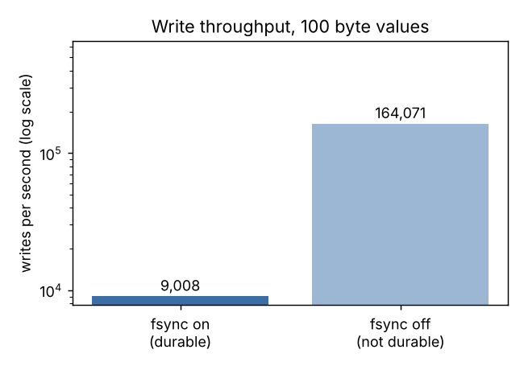
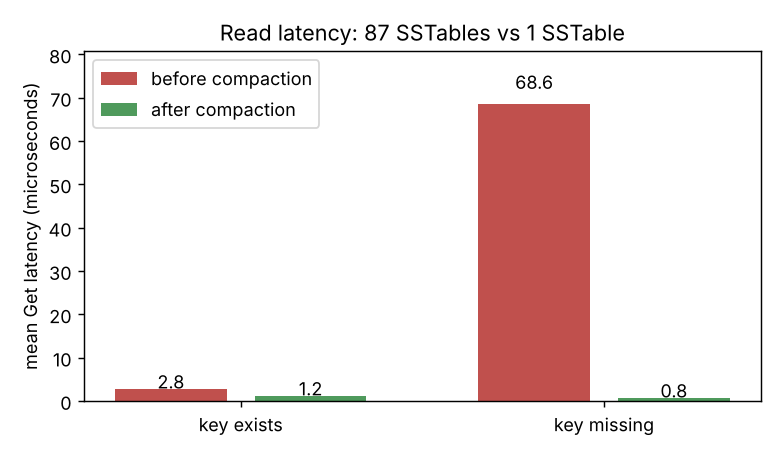
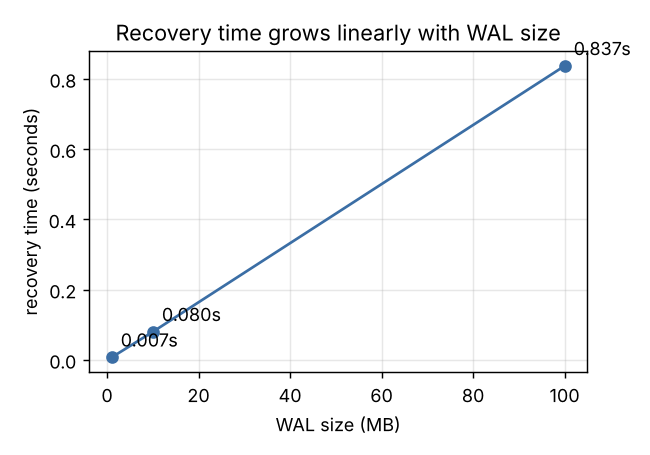

# Durable DB

A small key-value storage engine written from scratch in C++17 on Linux. It has a write-ahead log, SSTables, compaction, and crash recovery. No existing database or storage library is used.

I built it to understand how durability actually works, instead of just calling a database API. Every durability choice in here is something I implemented, tested, and can explain.

```
Put / Delete ──> WAL (fsync) ──> memtable ──(full)──> SSTable ──(4 tables)──> compaction
Get ──> memtable ──> SSTables, newest to oldest
```

## Features

- `Put`, `Get`, `Delete` on string keys and values (binary safe)
- **Write-ahead log** with CRC32 per record and `fsync` before a write is acknowledged
- **Crash recovery**: replays the WAL on startup, drops a torn or corrupted tail
- **SSTables**: sorted immutable files with a sparse index and a whole-file checksum
- **Compaction**: merges all tables, newest value wins, tombstones are dropped
- **MANIFEST** file so the set of live tables changes atomically
- A `flock` lock so two processes can't open the same directory
- 40 unit tests, an exhaustive crash test, and benchmarks

## Quick start

```bash
# needs: g++ (C++17), cmake, ninja (or make). GoogleTest is downloaded by CMake.
cmake -S . -B build -G Ninja
cmake --build build

./build/unit_tests              # 40 tests
tools/crash_test.sh build       # kill -9 the engine at many different moments
./build/bench /tmp/bench docs/bench_results   # benchmarks (use a real disk, not tmpfs)

# try it by hand
./build/durabledb_cli /tmp/mydb put name naga
./build/durabledb_cli /tmp/mydb get name
```

Use it as a library:

```cpp
#include "durabledb/db.h"

auto db = durabledb::DB::Open("/tmp/mydb");   // recovers automatically
db->Put("user:1", "naga");                     // true = durable on disk
auto v = db->Get("user:1");                    // std::optional<std::string>
db->Delete("user:1");
```

## How it works

### Files in the data directory

| File | What it is |
|---|---|
| `LOCK` | `flock`ed while the DB is open |
| `MANIFEST` | list of live SSTable ids. The single source of truth |
| `wal.log` | write-ahead log for the current memtable |
| `000001.sst`, ... | SSTables, higher number = newer |

### Write path

1. Encode the record and append it to `wal.log`
2. `fsync` the WAL
3. Only then insert into the in-memory table (memtable)
4. Return `true`. The write is now durable

If the append fails half way, the WAL is cut back to its old length, so a half-written record can never sit in front of later records (that would make replay stop early and lose acknowledged writes).

### Flush (memtable to SSTable)

When the memtable reaches 4 MB:

1. Write `NNNNNN.sst` to a `.tmp` file, `fsync`, `rename`, `fsync` the directory
2. Write a new `MANIFEST` the same atomic way
3. Reset the WAL

The order matters. If we crash after step 1 the new file is an orphan and gets deleted at startup (the WAL still has everything). If we crash after step 2 the WAL gets replayed on top of the table, which is harmless because replaying a `Put` twice gives the same result.

### Compaction

When there are 4 or more SSTables, all of them are merged into one:

1. Write the merged table
2. Atomically switch the `MANIFEST` to point at only the new table
3. Delete the old files

Tombstones are dropped because nothing older is left for them to hide.

**Why the MANIFEST exists:** my first plan found tables by listing the directory. That has a real bug. If we crash after writing the merged table but before deleting the old ones, the old tables still contain the value of a key that was deleted (its tombstone was dropped in the merge). On restart the deleted key would come back to life. With a MANIFEST the old files are just orphans and get removed. There is a unit test that recreates exactly this crash.

### Recovery on startup

1. Take the `flock`
2. Read `MANIFEST`. Delete any `*.tmp` and any `.sst` that is not listed
3. Open the live SSTables (checksum verified, a bad file is an error, not silently skipped)
4. Replay `wal.log` into the memtable. Stop at the first torn or corrupted record and truncate the file there

### On-disk formats

```
WAL record   | crc32 (4) | payload_len (4) | type (1) | key_len (4) | val_len (4) | key | value |
             crc covers payload_len and everything after it. All integers little-endian.

SSTable      [ data: records sorted by key ] [ sparse index: 1 entry per 16 records ]
             [ footer 24 B: index_offset (8) | index_count (4) | crc32 (4) | magic (8) ]
```

## Testing

### Unit tests (40)

| Area | What is checked |
|---|---|
| CRC32 | standard check value, detects a flipped bit |
| WAL | round trip, binary data, **torn tail at every single byte offset**, corrupted record, reset, failed append leaves no garbage |
| SSTable | every key found, missing keys (before, between, after), empty and single record tables, checksum catches corruption |
| Recovery | unflushed data returns from the WAL, torn WAL tail, **WAL cut at every offset gives a prefix of the writes** |
| Compaction | newest value wins, deletes stay deleted after restart, tombstones dropped, auto trigger |
| Crash safety | orphan files cleaned up, crash during compaction cleanup, crash between flush and WAL reset, corrupted table is reported, second process rejected |
| Faults | an injected I/O error during `Put` is not acknowledged and the DB keeps working |
| Randomized | 40,000 random ops vs `std::map` with random restarts and compactions, 5 seeds |

The whole suite also passes under AddressSanitizer and UBSan (`-DENABLE_ASAN=ON`).

### Crash tests

`tools/crash_test.sh` runs a writer that applies a known sequence of puts, overwrites, and deletes, and prints `ACK n` only after operation `n` returned. The engine is killed with `SIGKILL`, then the verifier reopens the database and checks it matches the model exactly. Every acknowledged op must be there, and nothing else. (The one op after the last ack may or may not have landed, so either state is accepted.) The verifier opens the DB twice to check that recovery is repeatable.

- **Mode 0:** the engine kills itself at *every* crash point of a 300-operation run (625 of them). Crash points are placed inside WAL append, and between each step of flush and compaction (`include/durabledb/fault.h`)
- **Mode 1:** same, at a random crash point, in a longer run with `fsync` on
- **Mode 2:** an outside `kill -9` at a random time

To check that the test can actually fail, I temporarily moved the WAL reset ahead of the MANIFEST update. The sweep caught it right away at the flush crash points.

**What this does not cover:** `kill -9` is a *process* crash. The OS page cache survives it, so this does not model power loss or a disk that lies about `fsync`. Testing that needs a VM that gets powered off or a tool like `dm-log-writes`.

## Benchmarks

Run on a 1 vCPU cloud VM, ext4, Linux 6.18. Your numbers will differ, mostly the `fsync` one. Raw CSVs are in `docs/bench_results/`.

### Write throughput (100 byte values)



| Mode | Writes/sec |
|---|---|
| `fsync` on every write | ~9,000 |
| no `fsync` | ~164,000 |

`fsync` costs roughly 18x. That gap is the price of durability, and is why real systems batch several writes into one `fsync` (group commit). I did not implement that.

### Read latency before and after compaction (200,000 keys)



| | key exists | key missing |
|---|---|---|
| 87 SSTables | 2.8 us | 68.6 us |
| 1 SSTable | 1.2 us | 0.8 us |

Missing keys are the expensive case because without a bloom filter every table has to be checked. Compaction fixes this by leaving one table to look at. Hits are cheap either way here because the test keys are inserted in order, so tables have disjoint key ranges and newer tables reject quickly.

### Recovery time vs WAL size



| WAL size | Records | Recovery |
|---|---|---|
| 1 MB | 8,065 | 0.007 s |
| 10 MB | 80,659 | 0.080 s |
| 100 MB | 806,596 | 0.837 s |

Linear in the WAL size, as expected. The memtable limit (4 MB by default) is what keeps real recovery time small, because the WAL is reset after every flush.

## Limitations (on purpose)

- Single threaded. One writer, no concurrent access
- Compaction merges everything at once and loads all tables into memory, so it is fine for small data sets but not for big ones
- Every `Get` for a missing key checks every table (no bloom filters)
- No range scans / iterators, no transactions, no compression
- Keys and values are limited by memory, and a single WAL record to 1 GiB
- If `fsync` itself fails, the engine returns an error but does not try to be clever about it (see the "fsyncgate" story for why that is a hard problem)

## Future work

- Streaming k-way merge in compaction instead of loading everything
- Bloom filter per SSTable
- Group commit (one `fsync` for many writes)
- Leveled compaction
- Iterator / range scans
- Skip list memtable instead of `std::map`
- Real power-loss testing

## Project layout

```
include/durabledb/   public headers: db, wal, memtable, sstable, crc32, io, coding, fault
src/                 db.cpp  wal.cpp  memtable.cpp  sstable.cpp
tests/               unit tests (GoogleTest)
tools/               crash_writer, crash_verify, crash_test.sh, durabledb_cli
bench/               bench_main.cpp, plot.py
docs/                implementation plan, charts, raw benchmark CSVs
.github/workflows/   CI: build with sanitizers, unit tests, crash tests
```

## What I learned

- `write()` is not durable. Only `fsync` is, and a `rename` is only durable after you `fsync` the directory
- Ordering is everything. Almost every bug I could think of was "step B happened before step A became durable"
- A checksum per record is how you tell a torn write from real data
- Deleting data is the hard part of an LSM tree: tombstones can only be dropped when nothing older is left, and a crash must never bring a deleted key back
- Tests that kill the process at every crash point find ordering bugs that normal tests never will
